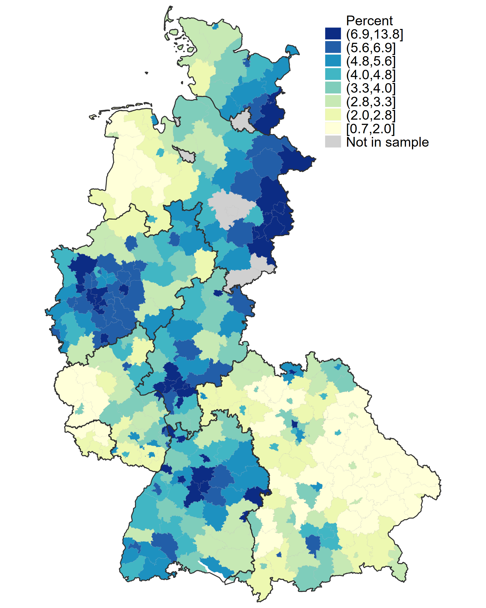
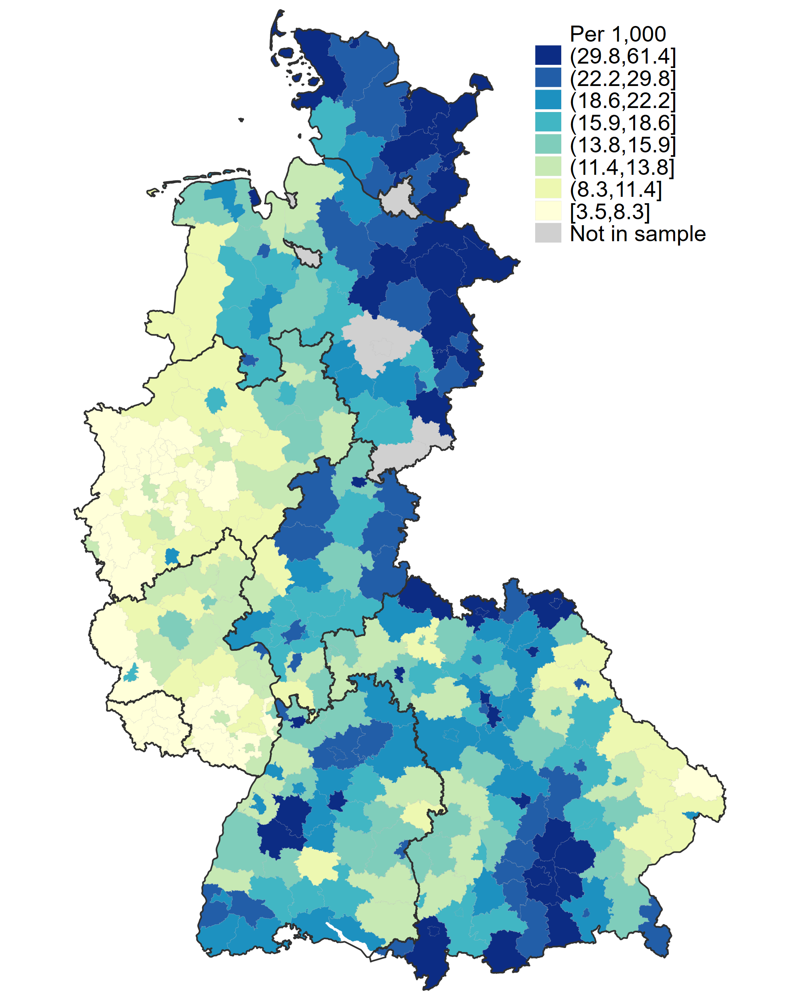



## German Internal Migration: A Marriage Market Perspective

[Download PDF](/files/Demir_JMP.pdf) &nbsp;&middot;&nbsp; [Read the full paper on this page](#full-paper)

### Abstract
This paper investigates whether the large young East–West migration after German reunification altered marriage formation and marital stability in receiving West German districts. I construct a newly assembled district panel of marriage, divorce and birth outcomes over 1985–2007 with observed cumulative young-adult arrivals from 1991 onward, scaled by fixed pre-reunification population. To address endogenous destination choice, I construct a shift-share instrument by multiplying each district's 1961 East-linked settlement share by the cumulative rate of young-adult arrivals from East Germany, calculated across sample districts in the other West German states. The preferred IV estimates show that districts receiving one additional young arrival per 1,000 residents had 0.027 fewer annual divorces per 1,000 residents, about 9 percent of the mean per standard deviation of exposure. The corresponding marriage estimate is -0.021, and statistically imprecise. Event studies on balanced district panels extending to the early 1980s do not reject the null of no differential pre-reunification divorce trends. Districts with stronger historical ties did not experience faster income growth after reunification, and the estimate is robust to controlling for income. Filing-side analyses do not detect a statistically significant difference between wife- and husband-initiated divorce responses. The evidence points to lower local divorce rates in more exposed districts.

<h3>Spatial Variation in Historical Ties and Migration Exposure</h3>

<figure style="margin: 1.5rem 0; background: #ffffff; padding: 16px; border-radius: 8px; border: 1px solid #e2e8f0; box-shadow: 0 1px 3px rgba(0,0,0,0.06);">
  
  <!-- Two-column grid replicating LaTeX subfigures -->
  

    
    <!-- Panel (a) -->
    

      
      

        (a) 1961 East-linked share
      

    

    <!-- Panel (b) -->
    

      
      

        (b) Arrivals aged 18–29, 1991–2006
      

    

  

  <!-- Shared Figure Caption -->
  <figcaption style="margin-top: 12px; padding-top: 10px; border-top: 1px solid #f1f5f9; font-size: 0.85rem; color: #334155; line-height: 1.45;">
    <strong>Figure: The 1961 East-linked share and cumulative arrivals of young adults from East Germany, by district.</strong>
    Panel (a) shows the 1961 census share of residents who relocated from the Soviet zone or East Berlin before the construction of the Berlin Wall (in percent of the 1961 population). Panel (b) shows cumulative arrivals aged 18–29 from the five eastern states in 1991–2006 per 1,000 residents in 1988. Classes are octiles of the 320 sample districts; thick lines denote state borders. The correlation between the share and exposure is 0.25 across all districts and 0.47 within states. <em>(Click either map to enlarge.)</em>
  </figcaption>

</figure>

### Full Paper


