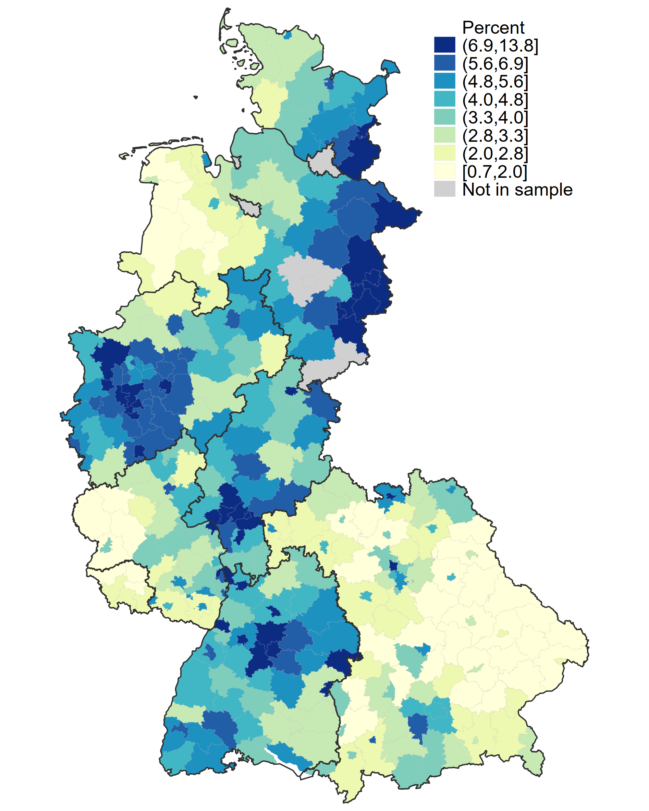
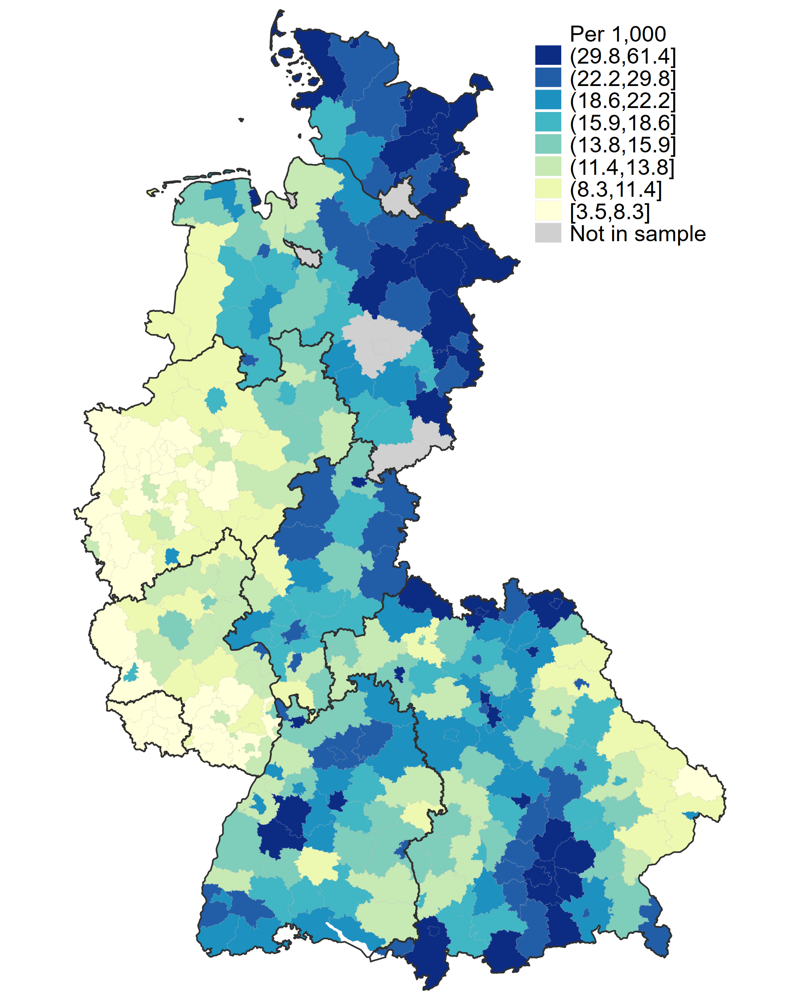



## German Internal Migration: A Marriage Market Perspective

[Download PDF](/files/Demir_JMP.pdf) &nbsp;&middot;&nbsp; [Read the full paper on this page](#full-paper)

### Abstract

This paper studies whether the large East–West migration after German reunification changed marriage and divorce in receiving West German districts. Using newly digitized district panels of divorces, marriages and births for 1985–2007, extending to 1980 for a subset, I compare districts within the same state by the share of their 1961 population that had moved from East Germany before the Berlin Wall. This share strongly predicts post-1991 arrivals. After reunification, divorce fell in proportion to the share: by about 2 percent of the mean per percentage point, and by 14 percent in the top relative to the bottom quintile, with no differential trends during the 1980s. The decline appears by 1994, a few years after the largest migration wave of 1989–1990; expressed per young arrival measured since 1991, it equals 0.027 fewer annual divorces per 1,000 residents. A placebo share of expellees without East German ties predicts neither migration nor divorce, and districts with stronger ties did not grow faster. Marriages do not rise, and the decline is far larger than the small induced change in sex ratios could produce. Fewer divorces without more marriages is the pattern predicted by rising costs of forming and dissolving households, not by a thicker partner market.

The IV estimate scales the historical-ties reduced form by measured post-1991 gross arrivals; it is not a constant marginal effect of each additional arrival. Higher household formation and dissolution costs are consistent with the findings, but the available district data do not test that channel directly.

<h3>Spatial Variation in Historical Ties and Migration Exposure</h3>

<figure style="margin: 1.5rem 0; background: #ffffff; padding: 16px; border-radius: 8px; border: 1px solid #e2e8f0; box-shadow: 0 1px 3px rgba(0,0,0,0.06);">
  
  <!-- Two-column grid replicating LaTeX subfigures -->
  

    
    <!-- Panel (a) -->
    

      
      

        (a) 1961 East-linked share
      

    

    <!-- Panel (b) -->
    

      
      

        (b) Arrivals aged 18–29, 1991–2006
      

    

  

  <!-- Shared Figure Caption -->
  <figcaption style="margin-top: 12px; padding-top: 10px; border-top: 1px solid #f1f5f9; font-size: 0.85rem; color: #334155; line-height: 1.45;">
    <strong>Figure: The 1961 East-linked share and cumulative arrivals of young adults from East Germany, by district.</strong>
    Panel (a) shows the 1961 census share of residents who had lived in the Soviet zone or East Berlin in 1939 and moved to the West after the war, together with their children born since (in percent of the 1961 population). Expellees from the former eastern territories are counted separately. Panel (b) shows cumulative arrivals aged 18–29 from the five eastern states in 1991–2006 per 1,000 residents in 1988. Classes are octiles of the 320 sample districts; thick lines denote state borders. The correlation between the share and exposure is 0.25 across all districts and 0.47 within states. <em>(Click either map to enlarge.)</em>
  </figcaption>

</figure>

### Full Paper


